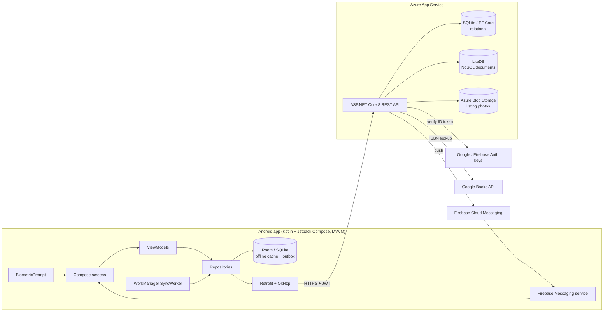
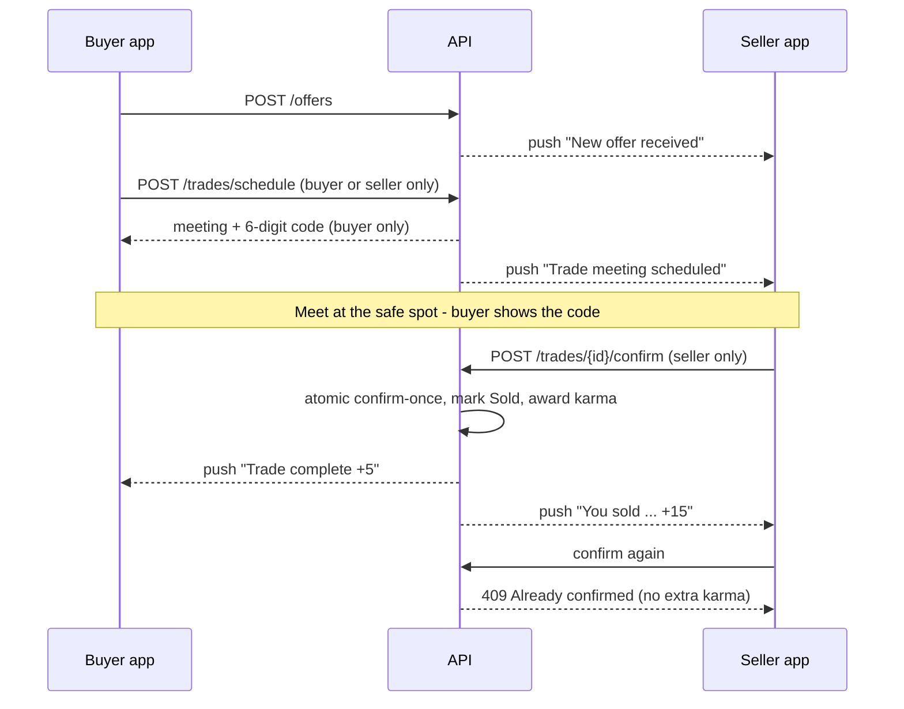
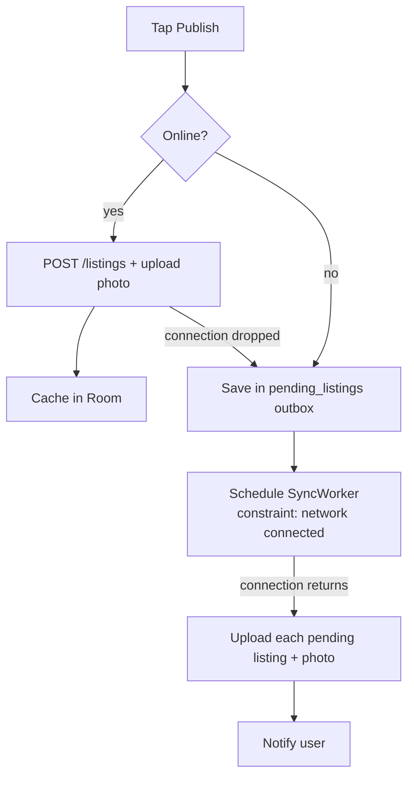

# Matrix Market - Peer-to-Peer Student Marketplace


> Replace `OWNER/REPO` in the badge above with your GitHub user/repo name.

**Matrix Market** is a campus-verified marketplace where students buy, sell, lend and trade
textbooks, electronics, residence essentials and tutoring - meeting at verified safe spots and
building a Student Score with every completed trade.

**Demo video (Final POE):** _add YouTube link here_ - Part 3 video: https://youtu.be/nASFOwTEzYc

## Team
| Name | Student number |
|---|---|
| Caleb Naidoo | ST10084625 |
| Reece Moodley | ST10460086 |
| Taytem Pillay | ST10441678 |

## Features (Final POE)

| Requirement | How Matrix Market does it |
|---|---|
| Register & login with **SSO** | Google Sign-In via Firebase; the API **verifies the Firebase ID token server-side** before issuing its own JWT. Email/password also supported (BCrypt). |
| **Biometric authentication** | Fingerprint / face unlock (AndroidX Biometric) on app launch, offered after first login, toggle in Settings. |
| **Settings** | Name (saved to API and cached session), language, notifications, biometric unlock, offline sync status, logout. |
| **REST API** (own, hosted on Azure) | ASP.NET Core 8 Web API, Swagger at `/swagger`. |
| **Offline mode with sync** | Room (SQLite) caches listings for offline browsing; listings created offline go into an outbox and **WorkManager** uploads them automatically when the connection returns. |
| **Real-time notifications** | Firebase Cloud Messaging push for new offers, meetings scheduled, trades confirmed and watched items sold, plus an in-app inbox. |
| **Multi-language** | English, Afrikaans, isiZulu - every screen, switchable in-app. |
| **UDF 1 - ISBN scanner** | CameraX + ML Kit; accepts only real book ISBNs (978/979 + check digit) and looks up the title. |
| **UDF 2 - Trade Meeting Scheduler** | Safe campus spots, date/time, 6-digit code: buyer shows it, seller confirms. Only the two parties can act. |
| **UDF 3 - Student Score & badges** | Karma + tiers + badges, awarded exactly once per confirmed trade. |
| **UDF 4 - Listing photos** | Gallery or camera, compressed on the phone, stored in **Azure Blob Storage**. |
| **UDF 5 - Saved listings (watchlist)** | Heart a listing; stored in the **NoSQL** database; watchers are notified when it sells. |

What changed since Part 2 (lecturer feedback): see **[docs/LECTURER-FEEDBACK-FIXES.md](docs/LECTURER-FEEDBACK-FIXES.md)**.

## Architecture



### Trade flow (UDF 2 + 3 with ownership checks)



### Offline mode



## Project structure

```text
.github/workflows/ci.yml        Build + test Android and API, upload APKs
android/                         Android app (open this folder in Android Studio)
  app/src/main/java/com/matrixmarket/app/
    auth/            Google SSO (Firebase) + BiometricHelper
    data/local/      SessionManager (DataStore) + Room database
    data/remote/     Retrofit ApiService, ApiClient, DTOs
    data/repository/ Repositories (offline-first listings)
    di/              AppContainer (dependency container)
    network/         ConnectivityObserver
    notifications/   FCM service, notification helper, token sync
    sync/            SyncWorker (WorkManager)
    ui/              Theme, components, navigation, screens
    util/            Validators, formatting, error parsing
  app/src/main/res/values{,-af,-zu}/strings.xml   English / Afrikaans / isiZulu
  app/src/test/     JUnit unit tests
backend/
  MatrixMarket.Api/        ASP.NET Core 8 API
  MatrixMarket.Api.Tests/  xUnit tests
docs/                      Feedback fixes, Azure setup, Play Store material
```

## Running it

### API
```bash
cd backend
dotnet run --project MatrixMarket.Api      # http://localhost:5000/swagger
dotnet test MatrixMarket.sln               # API unit tests
```
Azure configuration (push notifications + blob storage): **[docs/AZURE-SETUP.md](docs/AZURE-SETUP.md)**.

Demo accounts (seeded): `thabo.mokoena@myemeris.edu.za`, `amahle.dlamini@myemeris.edu.za`, `sam.pillay@myemeris.edu.za` ... password `Password123!`.

### Android
1. Android Studio (Koala or newer) > **Open** > the `android` folder > let Gradle sync.
2. The app talks to the deployed Azure API (`API_BASE_URL` in `app/build.gradle.kts`). For a local API on the emulator, change it to `http://10.0.2.2:5000/` and add `android:usesCleartextTraffic="true"` to the manifest.
3. Run on a phone or emulator (API 26+). For Google Sign-In, the computer's debug SHA-1 must be added in Firebase (`./gradlew signingReport`).
4. Unit tests: `./gradlew testDebugUnitTest`.

### Release build
`./gradlew assembleRelease` with signing details in `android/keystore.properties` (not committed), or let GitHub Actions build it from repository secrets. Play Store listing material: **[docs/play-store](docs/play-store)**.

## Testing & CI
Every push runs `.github/workflows/ci.yml`:
- Android: unit tests (validators, Student Score tiers, settings session refresh, offline save/fallback, login and trade-meeting ViewModels) and debug/release APK builds.
- API: xUnit tests (ISBN validation, trade ownership, confirm-once karma, NoSQL store, notifications).
- APKs and test reports are attached to each run under **Artifacts**.

## Screenshots
| | | | |
|---|---|---|---|
|  |  |  |  |
|  |  |  |  |

## References
- Android Developers (2024). *Jetpack Compose, Room, WorkManager, Biometric, CameraX documentation*. https://developer.android.com
- Firebase (2024). *Authentication, Cloud Messaging and verifying ID tokens*. https://firebase.google.com/docs
- Google (2024). *ML Kit Barcode Scanning*. https://developers.google.com/ml-kit/vision/barcode-scanning
- Microsoft (2024). *ASP.NET Core Web API & EF Core documentation*. https://learn.microsoft.com/aspnet/core
- LiteDB (2024). *LiteDB embedded NoSQL database*. https://www.litedb.org
- International ISBN Agency (2017). *ISBN Users' Manual* (check-digit calculation). https://www.isbn-international.org
- Android Developers (2024). *Show a biometric authentication dialog*. https://developer.android.com/identity/sign-in/biometric-auth
- Android Developers (2024). *Per-app language preferences*. https://developer.android.com/guide/topics/resources/app-languages
- Android Developers (2024). *Getting started with WorkManager*. https://developer.android.com/develop/background-work/background-tasks/persistent/getting-started
- Firebase (2024). *Verify ID tokens*. https://firebase.google.com/docs/auth/admin/verify-id-tokens
- Google (2024). *Google Books APIs - Using the API*. https://developers.google.com/books/docs/v1/using
- Microsoft (2024). *Quickstart: Azure Blob Storage client library for .NET*. https://learn.microsoft.com/azure/storage/blobs/storage-quickstart-blobs-dotnet
- Square (2024). *Retrofit: a type-safe HTTP client for Android and Java*. https://square.github.io/retrofit/
